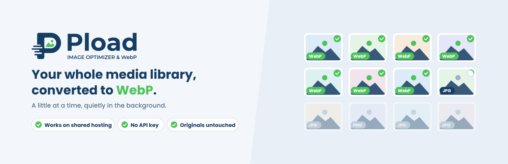
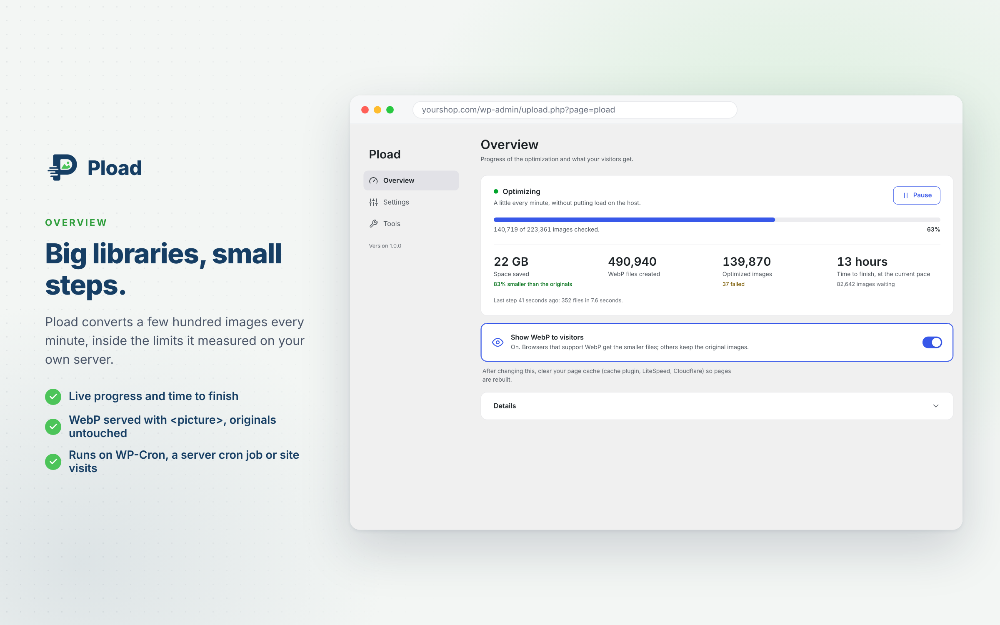
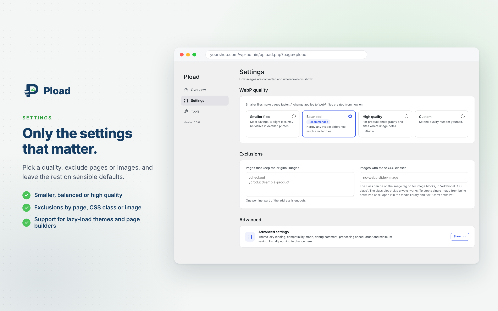
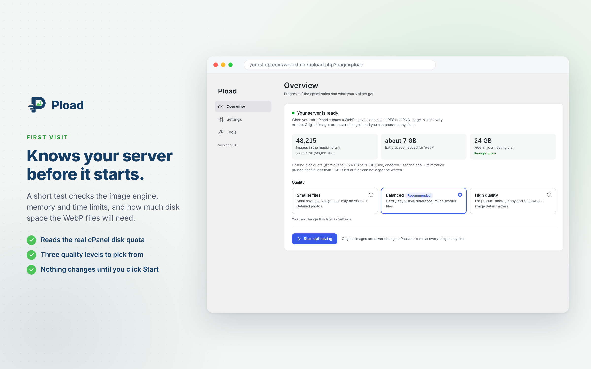
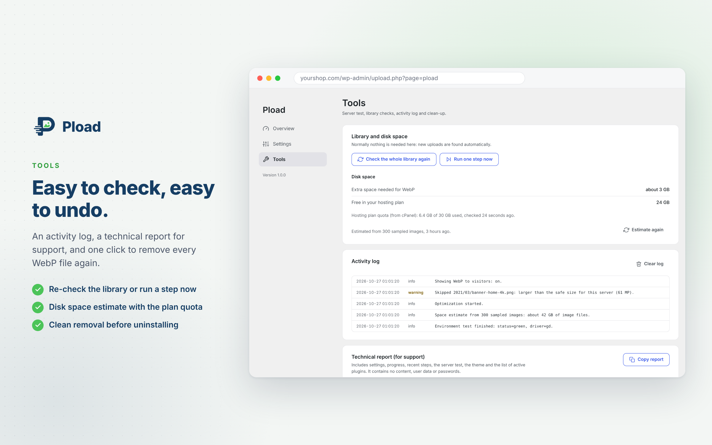

<p align="center">
  
</p>

<h1 align="center">Pload</h1>

<p align="center">
  <strong>Slow, steady image optimization for WordPress that shared hosting can survive.</strong><br>
  Converts your JPEG and PNG images to WebP a little at a time, so a large media library gets optimized without timeouts, memory errors or CPU warnings from your host.
</p>

<p align="center">
  <a href="https://wordpress.org/plugins/pload/"></a>
  <a href="https://wordpress.org/plugins/pload/"></a>
  
  
  <a href="LICENSE"></a>
</p>

<p align="center">
  <a href="https://wordpress.org/plugins/pload/">Download from WordPress.org</a> ·
  <a href="https://wordpress.org/support/plugin/pload/">Support forum</a> ·
  <a href="#roadmap">Roadmap</a>
</p>

---

## Why Pload

Most image optimizers try to convert the whole library as fast as possible. On a cheap shared host that usually ends badly. Pload takes the slow road on purpose:

1. **It tests your server first.** It checks which image engine works (Imagick or GD) and how much memory and time one step can safely use. It also estimates how much disk space the WebP files will need.
2. **It works in small steps.** Each background step stays inside the limits it measured. A library of 200,000 images takes a couple of days instead of crashing the site.
3. **It never touches your originals.** `photo.jpg` gets a `photo.jpg.webp` next to it. The WebP is kept only if it is really smaller.

Everything runs on your own server. Pload needs no account or API key and sends no images or data anywhere.

## Features

**Optimization**
- Server test and disk-space estimate before the first image is converted
- Background processing through WP-Cron, with fallbacks when WP-Cron is off or blocked: site visits, an open admin page, a server cron job or a free online cron service
- New uploads first, then the library (newest or oldest first)
- Three quality levels (70 / 75 / 85) or your own number, and a one-click rebuild after a change
- A minimum saving: a WebP is kept only when it is clearly smaller than the original
- Pauses by itself when disk space runs low. On cPanel it reads the real account quota, not the size of the whole server disk.

**Delivery**
- `<picture>` with a WebP `<source>`. No `.htaccess` rules, so it works on Apache, Nginx and LiteSpeed, and with page caches.
- Works with theme lazy loading, e.g. WoodMart and other themes that keep the real address in `data-src`
- Optional compatibility mode for images that page builders print without the WordPress image functions
- Optional CDN address for the WebP sources
- Exclusions by image, by page address or by CSS class (`pload-skip` always works)

**Media library**
- A Pload column with Optimize, Apply new settings and Don't optimize buttons that work without a page reload
- The saving for every image size, also in the attachment details
- Control over the maximum size of new uploads (WordPress keeps the original)

**Clean exit**
- One click removes every WebP file again, a little at a time, before you delete the plugin

## Screenshots

| Overview | Settings |
|---|---|
|  |  |
| **First run** | **Tools** |
|  |  |

## Benchmark

We tested Pload on real store photos against two popular optimizers, EWWW Image Optimizer and Imagify (free plans), and measured file size and visual quality (SSIM):

- **At the same visual quality, Pload's WebP files were about 3.5% smaller than EWWW's.**
- **Against Imagify, Pload at quality 70 saved 60.5% versus 51.4%, and still scored higher on SSIM (0.960 vs 0.951).**
- Pload's GD output matched the best reference libwebp setting (method 6).

These results are why the levels in 1.1 are 70 / 75 / 85: above 85, files grow a lot for little visible gain on typical WordPress photos.

## Requirements

- WordPress 6.0 or later
- PHP 7.4 or later
- GD or Imagick with WebP support. The built-in server test tells you if something is missing.

## Installation

Install **Pload** from *Plugins → Add New* in your dashboard, or download it from [WordPress.org](https://wordpress.org/plugins/pload/). Then:

1. Go to **Media → Pload**. The server test and the disk-space estimate run by themselves.
2. Pick a quality and click **Start optimizing**.
3. Once the first WebP files exist, turn on **Show WebP to visitors** and clear your page cache.

To install from this repository, download the source as a zip and upload it via *Plugins → Add New → Upload Plugin*.

## For developers

### Filters

| Filter | Type | Purpose |
|---|---|---|
| `pload_deliver` | `bool` | Turn WebP delivery off for the current request |
| `pload_shared_hosting` | `bool` | Override shared-hosting detection |
| `pload_home_dirs` | `string[]` | Folders searched for the cPanel quota file |

```php
// Example: never serve WebP on the checkout page.
add_filter( 'pload_deliver', function ( $on ) {
	return function_exists( 'is_checkout' ) && is_checkout() ? false : $on;
} );
```

### Structure

```
pload.php                    Plugin header, constants, loader
includes/
  class-pload-environment.php  Server test and per-step budget
  class-pload-queue.php        Queue, scheduling, lock, rest mode
  class-pload-runner.php       Fallback runners when WP-Cron is off
  class-pload-converter.php    Converts one attachment, size by size
  class-pload-drivers.php      GD and Imagick drivers
  class-pload-delivery.php     <picture>, theme lazy load, compatibility mode, CDN
  class-pload-space.php        Disk estimate, cPanel quota, auto-pause
  class-pload-media.php        Media library column and attachment details
  class-pload-admin*.php       Admin page (Overview, Settings, Tools)
assets/                        Admin and media-library CSS/JS
uninstall.php                  Removes settings, metadata and WebP files
```

Data is stored in options prefixed `pload_` and in the post meta `_pload`, `_pload_status` and `_pload_exclude`.

### Contributing

Issues and pull requests are welcome. Please keep in mind:

- Pload's core rule: **original files are never modified.**
- Every step must stay cheap enough for weak shared hosting.
- Code follows the WordPress Coding Standards and must pass [Plugin Check](https://wordpress.org/plugins/plugin-check/) without warnings.
- Prefix everything with `pload_` / `Pload_` / `PLOAD_`. All UI strings must be English and translatable with the `pload` text domain.

### Translations

Translations are managed on [translate.wordpress.org](https://translate.wordpress.org/projects/wp-plugins/pload/). Persian (fa_IR) is complete. Help with other languages is very welcome.

## Roadmap

- **1.2:** LCP-friendly lazy loading (no lazy for above-the-fold images, `fetchpriority`), optional local AVIF, optional rewrite-based delivery
- **1.3:** Custom folders (theme and plugin images), WP-CLI commands, optional compression of the original files (with a backup)

See the [changelog](https://wordpress.org/plugins/pload/#developers) for released versions.

## License

Pload is free software, released under the [GNU General Public License v2 or later](https://www.gnu.org/licenses/gpl-2.0.html).
